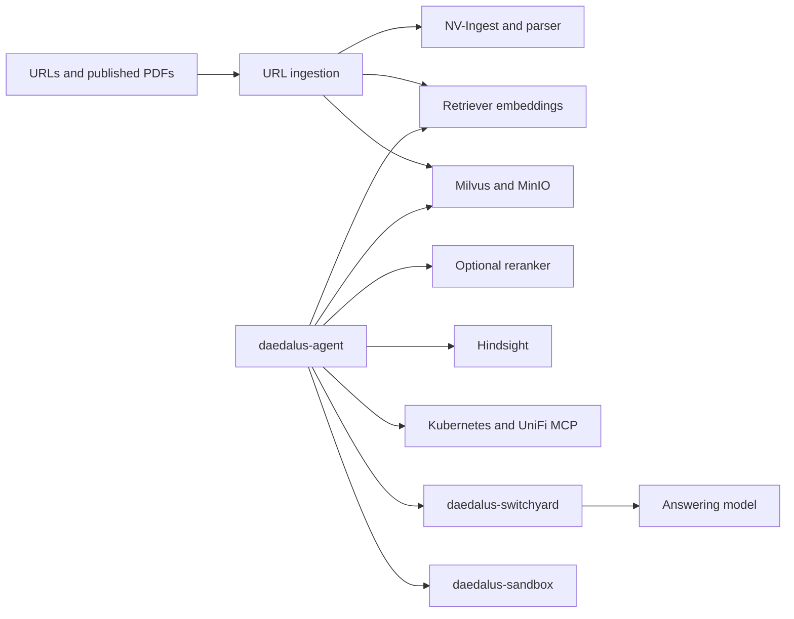

# Daedalus Context

Daedalus Context is the retrieval, ingestion, and infrastructure-tool stack for
[daedalus-agent](https://github.com/tuttlebr/daedalus-agent). Its services share
one deployment workflow, one namespace, and explicit contracts for document
sources, embeddings, collections, and consumer APIs.

This is a monorepo of cooperating services. Each component owns its
implementation, tests, and Helm chart. The root [Makefile](Makefile) coordinates
them. **Kubernetes is the supported runtime**;
[docker-compose.yaml](docker-compose.yaml) is only the image build and publication
inventory.

The checked-in deployment describes the author's Daedalus cluster. It includes
specific node names, GPU scheduling, storage classes, LAN access, and registry
mirrors. A new cluster needs reviewed configuration; this is not a laptop demo.
Local source and chart checks work without a cluster or credentials.

## Start here

| Goal | Start with |
| --- | --- |
| Understand the integrated system | [Stack model](#stack-model) |
| Develop or review a component | [Contributing](CONTRIBUTING.md) |
| Install on a new cluster | [Deployment guide](docs/deployment.md) |
| Update, ingest, diagnose, or recover | [Operations guide](docs/operations.md) |
| Prepare a public release | [Publication guide](docs/publication.md) |
| Find a command and its side effects | `make help` |

For a first local check, install Python 3.12, GNU Make, Bash, and Helm 3, then
run from this checkout:

```bash
python3 -m venv .venv
source .venv/bin/activate
python3 -m pip install -r requirements-dev.txt
make validate-context
```

This validates this repository's contracts, Python contract tests, and seven
charts. It does not load production credentials, contact Kubernetes, or require
the adjacent Hindsight repository. See [Contributing](CONTRIBUTING.md) for full
source checks and tool versions.

For an already configured cluster, the service workflow is:

```bash
set -a
source .env
set +a
# EXPECTED_CONTEXT in .env must be an approved literal cluster context.
make deploy
make health-dependencies
make render-agent-env
# After configuring and deploying daedalus-agent:
make health-stack
```

Follow the [deployment prerequisites](docs/deployment.md#prerequisites) first.
`make deploy` installs selected services and checks provider health. Publishing
images, publishing a corpus, and populating collections are separate operations.

## Stack model

Seven services are owned here. Hindsight is an eighth, externally owned
integration. `daedalus-agent` is the consumer and is deployed from its own
repository. Neither external repository is required for local context checks.

| Component selector | Owner and guide | Responsibility |
| --- | --- | --- |
| `milvus` | [nim-milvus-ms](nim-milvus-ms/README.md) | Vector database, etcd, and MinIO object storage |
| `retriever` | [nemotron-retriever](nemotron-retriever/README.md) | Query/document embeddings and optional reranking |
| `nv-ingest` | [nv-ingest](nv-ingest/README.md) | Document extraction and local Nemotron parser |
| `pdf-server` | [pdf-server](pdf-server/README.md) | Versioned source PDF corpus and read-only HTTP serving |
| `url-ingest` | [url-ingest](url-ingest/README.md) | Source discovery, resumable refresh, embedding, and collection writes |
| `k8s-mcp` | [k8s-multicluster-mcp](k8s-multicluster-mcp/README.md) | Authenticated Kubernetes tools |
| `unifi-mcp` | [unifi-network-mcp](unifi-network-mcp/README.md) | Authenticated UniFi tools |
| `hindsight` | `HINDSIGHT_ROOT` / `charts/daedalus-hindsight` | Durable memory, managed in the adjacent `daedalus-hindsight` repository |



The Agent owns orchestration, authenticated user scope, tool results and
citations. It calls context services and the sandbox directly; Switchyard owns
answering-model routing and transport. Retrieved evidence returns to the Agent
and enters its next model continuation through Switchyard. Context does not
select answering models or own sandbox execution. Hindsight implementation
remains external to this repository.

The [topology](stack/topology.yaml) declares deployment dependencies and failure
boundaries. The orchestrator orders selected dependencies, blocks their
dependents on failure, and reports outcomes as JSON. It does not automatically
add omitted dependencies: include them or establish that they are healthy.

Core chat can operate without context services. Existing search needs Milvus
and embedding inference; it does not depend on the ingestion scheduler.
Reranking is optional. Ingestion failures affect new content while preserving
existing search. Optional MCP failures do not disable retrieval.

## Configuration

Use one root `.env`, based on [.env.example](.env.example), for operator settings.
Component-local `.env` files are not deployment inputs. Hindsight is the
exception: its owning repository manages its own runtime credentials.

| Authority | What belongs there |
| --- | --- |
| [Makefile](Makefile) and root `.env` | Workflow selection, operator overrides, image references, context guard |
| [stack/topology.yaml](stack/topology.yaml) | Service ownership, endpoints, dependencies, failure policy |
| [stack/components.lock.yaml](stack/components.lock.yaml) | Reviewed release inventory and model revisions |
| [stack/environments](stack/environments/) | Acceptance policy and required collections |
| [stack/rag-schema.yaml](stack/rag-schema.yaml) | Embedding space, database, dimensions, ranking contract |
| [stack/collections.yaml](stack/collections.yaml) | Collection aliases, schedules, chunking, freshness |
| Each component's `chart/` | Kubernetes resources and component configuration |
| [docker-compose.yaml](docker-compose.yaml) | Local image build contexts and publish references |

`ENVIRONMENT=development` selects a different acceptance policy; it does not
select smaller charts or replace hardware settings. The supported shared
namespace is `daedalus`. Read the
[configuration and override rules](docs/deployment.md#configuration) before
adapting the reference deployment.

## Daedalus integration

`make render-agent-env` prints the non-secret consumer contract derived from
the stack files. Merge it into the Agent's deployment configuration and supply
matching credentials through your secret-management process. The generated
file is a contract, not an Agent deployment or a credential bundle.
The ingestion consumer uses `NV_INGEST_HOST` and `NV_INGEST_PORT`;
`NV_INGEST_ENDPOINT` is also emitted for URL-based integrations. Merge these
settings into every Agent worker that ingests documents. Private upload storage
and its credentials remain part of the Agent deployment, separate from curated
collection refreshes.

Query and document embeddings must use the same model revision and vector
space. Equal dimensions alone do not establish compatibility. Daedalus uses
`/rerank`; NIM-compatible clients use `/v1/ranking`. Reranker scores are raw
logits, so probability thresholds need model-specific calibration.

Validate provider readiness, dependency/data health, and consumer requests
separately. See [health and diagnostics](docs/operations.md#health-and-diagnostics).
For changes spanning this stack, the Agent, Switchyard or sandbox in the parent
Daedalus monorepo, use its `.agents/skills/daedalus-co-design/` workflow alongside
this repository's maintenance skill. Context-only validation remains usable
without the sibling repositories.

## Continuous refresh and embedding generations

Deploying services does not populate collections. Publish source PDFs, submit
explicit collection refreshes, inspect completion and retrieval, then enable
schedules. [Data operations](docs/operations.md#data-operations) describes the
commands and their effects; [URL ingestion](url-ingest/README.md) defines resume,
replacement, deletion, and freshness behavior.

## Development

[Contributing](CONTRIBUTING.md) covers dependencies, tests, generated files, and
changes spanning components. CI validates owned code and charts without a live
cluster. `make validate-local` adds full source checks and disposable builds;
`make validate-cluster` is a separate guarded, read-only cluster gate.

Agent instructions live in [AGENTS.md](AGENTS.md) and the repository's
[operate-daedalus-context skill](.agents/skills/operate-daedalus-context/SKILL.md).
Documentation describes current behavior; completed reviews and migration
history belong in Git.

## License

A license for the repository's original code has not been selected. Existing
[third-party notices](nemotron-retriever/chart/files/nemotron-rerank-notices/THIRD_PARTY_NOTICES.md)
remain in force for the material they describe. See the
[publication guide](docs/publication.md) before distributing code, images, or data.
